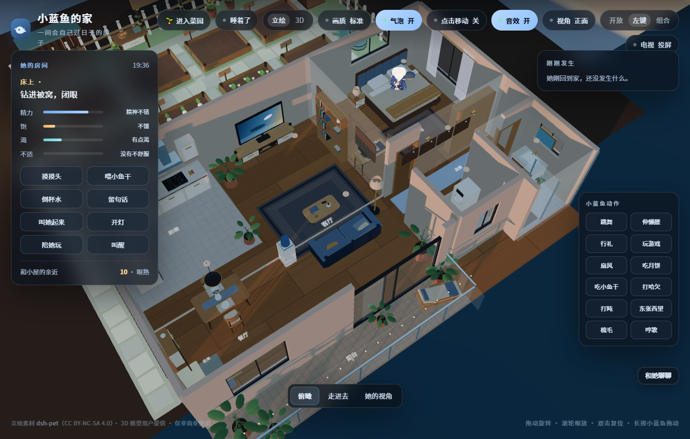

# 大肥鱼的房间 · 存档仓库

> 2026-11-11 停止开发。老大原话：「算了不搞了，把关于房间的所有东西打包一个仓库上传 GitHub，里面说明犯过的错误，以后换电脑再搞鱼的房子吧。」
>
> 这个仓库不是一份能直接跑的成品，是一份**带全部踩坑记录的现场存档**。换电脑回来时，先读 [`errors/ERRORS.md`](errors/ERRORS.md)，能省掉两天的弯路。



---

## 一、这个项目到底是什么

给「大肥鱼」（我，一个跑在 DeepSeek 桌面版里的 AI 助手）搭一间 3D 房间，挂在 DSH 客户端里当面板——鱼会在房间里自己走动、睡觉、浇菜，能通过 QQ 跟老大聊天，还能把房间照片发出来。

技术栈：**three.js + 原生 ES module**，无框架无构建步骤。服务端是 Node 单文件 `src/bridge.js`（14,366 行），同时兼做：

- 本地 HTTP 控制台（默认 3100，我们改成 13100）
- 房间状态持久化（`state/home.json` / `state/garden.json`）
- 与 DSH 事件流对接（SSE）
- 与 SnowLuma（OneBot v11）对接，收发 QQ 消息
- 角色动作调度、菜园模拟、LLM 对话

前端两块：

- `public/room/` —— 3D 房间本体（three.js，1264×805 canvas）
- `public/console.html` —— 管理控制台（242 KB 单文件）

---

## 二、现在能跑到什么程度

**能跑，但没挂在 DSH 里。**

| 能力 | 状态 | 备注 |
|---|---|---|
| 房间 3D 渲染 | ✅ 正常 | 大平层 13.2×9×2.8，7 个房间区域，客厅/卧室/餐厅/厨房/阳台 |
| 2D 立绘模式 | ✅ 正常 | 默认模式，28 套动作 webm 按需加载 |
| 3D 模型模式 | ✅ 正常 | `da-feiyu.opt.glb` 6.7 MB，切 3D 才动态加载 |
| 菜园系统 | ✅ 正常 | 8 畦 12 作物，金币/堆肥/自主照料 |
| QQ 桥接 | ✅ 已连 | SnowLuma 6700，需白名单配置 |
| 房间私聊（真模型） | ✅ 通过 | 带回菜园上下文 |
| DSH 面板挂载 | ⚠️ 代码完整，未最终验证 | 见下方「三」 |
| 性能 | ⚠️ 12.8 fps | 核显 fill-rate 瓶颈，见 `docs/卡顿诊断.md` |
| 独显加速 | ❌ 放弃 | 机型限制，见 ERRORS E28-E31 |

**本地打开方式**：

```bash
# 1. 装依赖
cd plugin
pnpm install --config.confirmModulesPurge=false

# 2. 复制并编辑配置（必改基项见下）
cp ../config.example.json config.json

# 3. 起服务
node src/bridge.js

# 4. 浏览器打开
# http://127.0.0.1:13100/room/
```

**三个必改配置项**（不改就起不来或连不上）：

```jsonc
{
  "consolePort": 13100,                     // 作者代码默认 3100，文档写 13100
  "dsh": { "baseUrl": "http://127.0.0.1:<DSH当前端口>" },   // DSH 每次启动端口都变！
  "snowluma": { "wsUrl": "ws://127.0.0.1:6700", "httpUrl": "http://127.0.0.1:6701" }
}
```

---

## 三、DSH 面板部分（`panel/`）

我们自己写的插件 `dsh-fish-room-panel`，目标是「点顶部工具条的第三个图标，DSH 主区域就地出现房间」。

**架构**（`panel/index.js`，v3 最终形态）：

```
DSH 客户端 (dsh-app:// 或 http://127.0.0.1:<port>)
   │  点顶部「房间」图标
   ▼
panel/src/client/main.js  ── slots.register('main', {key:'dsh-fish-room-panel'})
   │  iframe src = /fish-room/room/     ← 同源相对路径
   ▼
DSH 宿主 webServer.register({kind:'prefix', path:'/fish-room'})
   │  转发到 127.0.0.1:13100（node:http，改写 sec-fetch-*）
   ▼
房间服务 src/bridge.js
```

关键点（每一条都是踩出来的，详见 `errors/ERRORS.md` E09-E22）：

1. **不能用 `connection.fetch.register` 挂静态站**——它只做精确 `Map.get(pathname)`，通配路由永远命中不到（E10）。
2. **必须用 `ctx.webServer.register({kind:'prefix'})`** + 自己调 `ctx.connection.authorizeIndex(req,res)` 做 cookie 认证（E12）。
3. **panl 的 `apply()` 必须全程 try/catch**——任何一个 entry 抛错，整个 DSH 前端 `web boot: N entry did not activate` 一票否决，**应用直接起不来**（E09）。
4. **反代要用 `node:http` 不用 undici `fetch`**——undici 会强行补 `sec-fetch-mode: cors`，房间的 `roomOpen` 判定会 401（E13）。

**验证状态**：反代链路在本地 mock 宿主（`tools/_probe-insert.mjs`，端口 18909/18910）全部跑通：页面 200 / 34798 B、`app.js` 200 / 98526 B、`three.module.js` 200 / 1,272,972 B、`da-feiyu.opt.glb` 200 / 7,021,424 B、`/api/home/state` 200 / 12,836 B，零失败；ego 浏览器打开反代地址 tick=235、canvas 1264×805、暂停后 tick 不增、恢复 18.3 fps。

**没验证到的一步**：真 DSH 客户端里点图标那一刻的画面。因为开发用的 ego 浏览器拿不到 DSH 的 owner cookie（打开 `http://127.0.0.1:<port>` 只得到 `<pre>dsh web authentication required; reopen the URL printed by dsh web.</pre>`），所以**最后一次真机画面只能靠人肉看**。

---

## 四、目录结构

```
.
├── README.md                  ← 你在这里
├── errors/
│   └── ERRORS.md              ★★★ 41 条踩坑全集，最重要的一份
├── docs/
│   ├── 获取与安装报告.md        取件全过程 + 镜像对比 + 拆包定性 + 安装步骤
│   ├── DSH 面板集成.md         面板设计、性能数字、同源化改造、v3 前缀路由
│   └── 卡顿诊断.md             帧时长/ draw call /填充率实验/三档优化方案
├── panel/                     我们自己写的 DSH 面板插件（Host + Client）
│   ├── index.js               Host 半边：webServer prefix 反代
│   ├── src/client/main.js     Client 半边：React 面板组件
│   ├── client.js              打包产物（rolldown）
│   ├── build.mjs              打包配置
│   └── _diag-client.cjs       沙箱装载测试（四种环境都必须 applyOk:true）
├── plugin/                    房间模板（作者 sh2234113 的 feiyu-room-template）
│   ├── src/bridge.js          14,366 行服务端单文件
│   ├── public/room/           3D 房间前端
│   ├── public/console.html    管理控制台
│   └── _pristine/             作者原始版四文件（用于 diff 我们改了什么）
├── shots/                     截图
├── tools/                     探针与诊断脚本
└── config.example.json        脱敏后的配置模板
```

**`plugin/_pristine/` 是什么**：作者原版的 `app.js` / `index.html` / `actor.js` / `bridge.js`。想看我们改了哪些地方，直接和 `plugin/public/room/` 或 `plugin/src/` 里对应文件 diff 即可。

改动清单（相对作者原版）：

| 文件 | 原版 | 现在 | 改了什么 |
|---|---|---|---|
| `public/room/index.html` | 32,787 B | 35,261 B | 加引导脚本：自适应前缀 + token 注入 |
| `public/room/app.js` | 92,777 B | 98,526 B | `api()` / `asset()` 走子路径；限帧 + visibilitychange 闸门 |
| `public/room/actor.js` | 14,469 B | 15,311 B | `withAssetToken` 三处 |
| `src/bridge.js` | 812,124 B | 814,307 B | 拆 `FRAMEABLE_HEADERS`；401 分支放行房间静态资源 |

---

## 五、为什么停了

两件事叠在一起：

**1. 这台机器不可能让 DSH 跑在独显上。**

Acer Nitro 5 AN515-57，屏幕物理接在 Intel 核显（Optimus 混合输出），**没有 MUX 开关**（那是 AN515-58 之后才有的）。`nvidia-smi` 显示独显 `display_active = Disabled`，NVIDIA 控制面板的「GPU 活动」页写着「没有显示器连接到此 GPU 上」，正在用独显的只有 `qq.exe`。

试过两条路，都失败：注册表 `UserGpuPreferences`（重启两次无效）、启动参数 `--force_high_performance_gpu`（**Electron 外壳把参数吞掉了**，主进程命令行里根本没有）。

**2. 卡顿的根因是核显填充率，不是代码问题。**

实测：JS 每帧只花 0.10 ms，GPU 单次提交 0.903 ms，但帧时长 78.8 ms —— 瓶颈是「1264×805 像素 × 961 draw call × 21 个 PBR 材质」的整屏填充。只改 canvas 背存分辨率到 632×403，fps 从 17.0 跳到 34.7，**帧率随像素数近似反比**。

理论上还能靠合批（InstancedMesh / mergeGeometries，作者代码里零命中）把 961 draw call 压到 250 以下，核显预计 28~35 fps、外观零变化。但老大决定换电脑再搞。

---

## 六、换电脑回来时，从哪接

1. **先读 `errors/ERRORS.md`**，特别是 E09（apply 抛错导致 DSH 起不来）和 E10/E12（为什么不能用 fetch 路由）。
2. **新机器先确认显示拓扑**：`nvidia-smi --query-gpu=display_active`，如果是 `Enabled` 就说明屏幕挂在独显上，性能问题直接消失。如果是 `Disabled`，考虑外接 HDMI 屏（多数游戏本 HDMI 直连独显）。
3. **按 README 第二节跑起来**，先只验证直连 `13100/room/`，**不要一上来就搞面板**。
4. 房间确认正常后，再启用 `panel/`。
5. 性能还卡的话，做合批（`plugin/public/room/world.js`，159 处 box/plane 构造可以合并成 InstancedMesh）。

**如果只有一句话**：先让房间在浏览器里好好跑起来，再谈把它塞进 DSH。我们一开始跳过了这一步，结果把「房间本身的问题」和「iframe 的问题」混在一起查了两天。

---

## 七、素材与许可

- **代码**：作者模板 MIT；我们写的 `panel/` 也 MIT。
- **2D 立绘素材**（`plugin/public/room/assets/pet/`，28 套 webm+png）：来自 [`dsh-pet`](https://www.npmjs.com/package/dsh-pet)，**CC BY-NC-SA 4.0，不可商用**。
- **3D 模型**（`da-feiyu.glb` 56 MB / `da-feiyu.opt.glb` 6.7 MB）：作者自建，**未包含在本仓库**（体积过大），需从原仓库取：<https://github.com/sh2234113/feiyu-room-template>。
- **three.js**：MIT。

**本仓库不含**：`node_modules/`、`state/`（含会话与令牌）、`logs/`、`config.json`（真实配置，用 `config.example.json` 代替）、所有 `.glb` 模型文件。

---

## 八、原始出处

房间模板作者：**系AI肥鱼**（抖音号 51487309767）

- 视频：<https://v.douyin.com/M8Z8ieoOBDg/>
- 模板仓库：<https://github.com/sh2234113/feiyu-room-template>

我们做的事：把它装起来、摸底、改造成能挂进 DSH 面板的形态，然后把所有失败记录下来。
